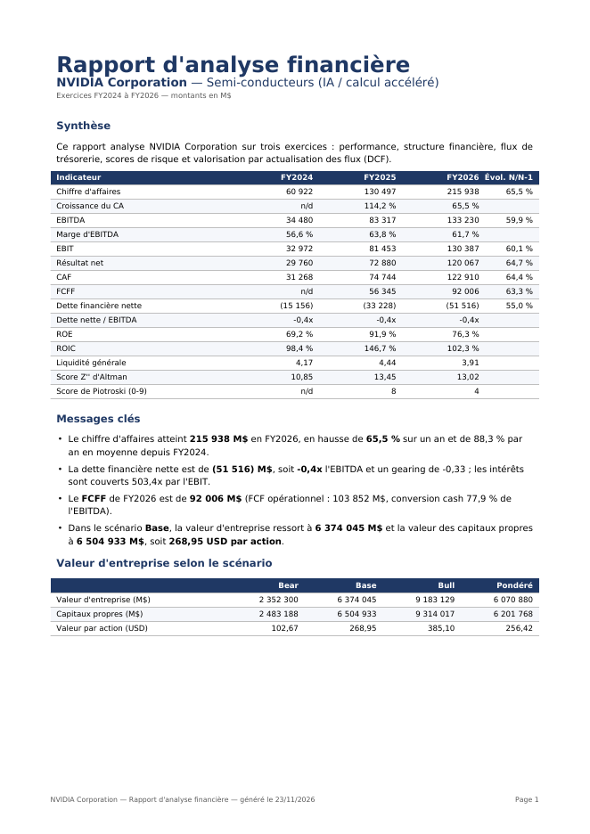
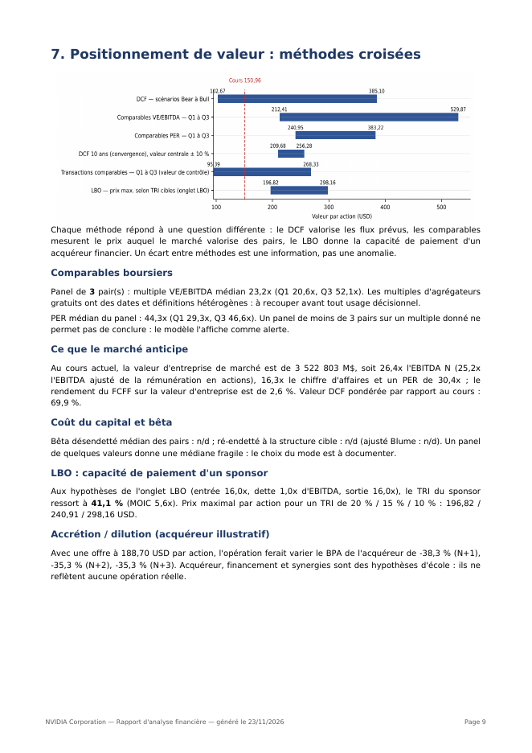
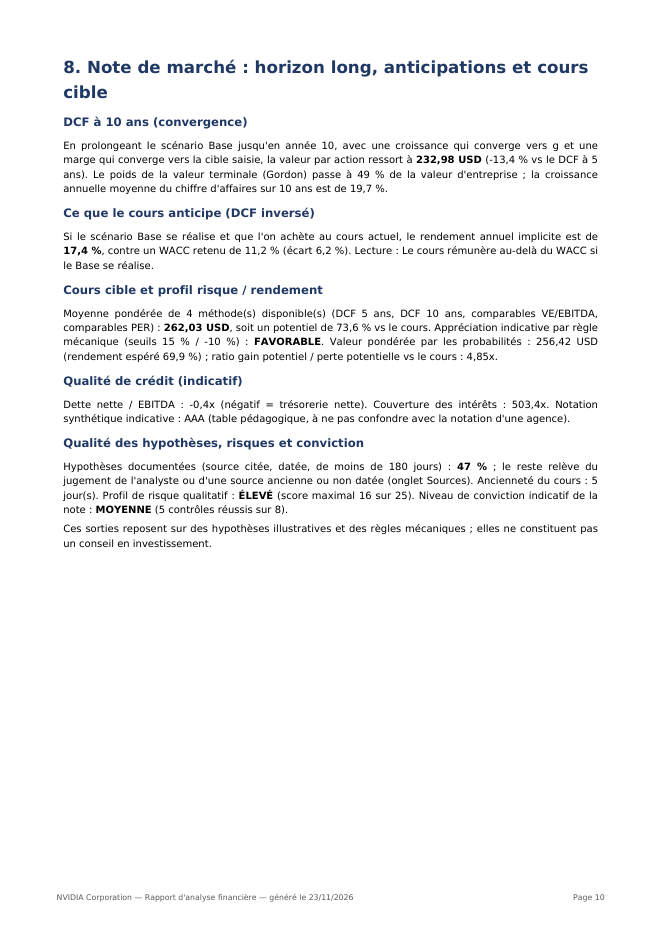

# finance-toolkit — analyse financière et valorisation automatisées

 

> **Avertissement.** Outil d'analyse et de formation. Les hypothèses de valorisation des exemples sont **illustratives**, les données de pairs viennent de sources gratuites et parfois datées, et les « appréciations » de la note de marché sont des règles mécaniques. Rien ici ne constitue un conseil en investissement ni une recommandation.

Collez un bilan et un compte de résultat sur 3 exercices dans un classeur Excel : SIG, CAF, BFR, flux, ratios, scores (Altman, Piotroski), DuPont, variations N/N-1, **DCF à 3 scénarios**, **comparables / football field**, **bêtas de pairs**, **LBO**, **accrétion-dilution**, **DCF à 10 ans avec convergence**, **DCF inversé** (rendement implicite au cours), **transactions comparables** et une **note de marché** (cours cible, risque/rendement, crédit synthétique, niveau de conviction) se calculent seuls ; un **registre des sources**, des **données de marché datées avec consensus** et une **analyse qualitative** (concurrence, risques, catalyseurs) documentent les hypothèses. Un script génère ensuite un rapport PDF.

*(English version: [README.md](README.md))*

## Aperçu
| Rapport PDF (page de garde) | Méthodes croisées (football field) | Note de marché |
|---|---|---|
|  |  |  |

*Exemple NVIDIA, hypothèses illustratives.*

## Démarrage rapide
```bash
pip install -r requirements.txt
python src/build_workbook.py --blank --out Modele.xlsx                 # classeur vierge
python src/build_workbook.py --data data/examples/wavestone_public.json --out Wavestone.xlsx   # exemple réel
python src/build_workbook.py --data data/examples/lvmh_public.json --out LVMH.xlsx             # grand groupe
python src/build_workbook.py --data data/examples/nvidia_public.json --out NVIDIA.xlsx         # US GAAP, hypercroissance
python src/analyse.py Wavestone.xlsx Rapport.pdf                       # rapport PDF
python -m pytest -q                                                    # tests
```
Importer une balance ou un FEC : `python src/import_balance.py --template Modele.xlsx --out Dossier.xlsx --files bal_N-2.csv bal_N-1.csv bal_N.csv` (mapping PCG éditable : `data/pcg_mapping.csv`).

Dans Excel : remplir **Saisie** (cellules jaunes), régler **Hypotheses**, vérifier que tous les contrôles de **Synthese** sont « OK ».

## Contenu
| Dossier | Rôle |
|---|---|
| `src/` | générateur du classeur, rapport PDF, import balance/FEC |
| `data/examples/` | société fictive, **Wavestone**, **LVMH** et **NVIDIA** (données publiques), classeurs et rapports PDF générés |
| `data/samples/` | balances synthétiques (aucune donnée réelle) |
| `data/peers/` | panel de pairs semi-conducteurs (fondamentaux FY2023-24, source SEC) et sa note de source |
| `tools/` | générateur de balances synthétiques, construction du panel de pairs (`requirements-peers.txt`) |
| `tests/` | 79 tests : zéro erreur de formule, cohérence comptable, valorisation, aller-retour d'import, validation sur chiffres publiés |
| `docs/` | `METHODOLOGIE.md`, `VALIDATION.md` (écarts et défauts trouvés) |

## Validation et limites
Le modèle reproduit les chiffres publiés de Wavestone (`docs/VALIDATION.md`), de LVMH (`docs/VALIDATION_LVMH.md`) et de NVIDIA, sous US GAAP (`docs/VALIDATION_NVIDIA.md`) : ventes, résultat opérationnel, résultat net, total bilan, EBITDA, trésorerie nette. Ces notes détaillent aussi les **écarts de définition** et ce que la validation ne prouve pas. Les hypothèses de valorisation fournies sont illustratives ; les données de pairs viennent d'agrégateurs gratuits et sont à recouper. **Outil d'analyse et de formation : ne constitue pas un conseil en investissement.**

## Onglets du classeur
Saisie · Hypotheses · Synthese · **Reco_Marche** · SIG_CAF · Bilan_BFR · Cashflow · Ratios · Scores · Variations · DCF · Comparables · WACC_Pairs · LBO · MA · **DCF_10ans** · **Transactions** · **Sources** · **Marche** · **Qualitatif** · Seuils. Détail des méthodes : `docs/METHODOLOGIE.md`.

## Données et sources
Chiffres des sociétés : communiqués et documents d'enregistrement publics (voir chaque note `docs/VALIDATION_*.md`). Panel de pairs : états SEC extraits d'un jeu Hugging Face sous licence GPL ; seuls des ratios calculés sont versionnés (`data/peers/README.md`). Les cours et capitalisations des exemples proviennent d'agrégateurs gratuits, datés dans les notes : à remplacer par une source professionnelle pour tout usage sérieux.

## Date des données de l'exemple NVIDIA

L'exemple NVIDIA est arrêté au 23/11/2026 : cours de clôture du 20/11/2026 (125,53 $), résultats du troisième trimestre de l'exercice 2027 (communiqué du 17/11/2026), consensus des analystes du 18/11/2026. Les multiples des pairs datent du 28/10 et du 11/11/2026 et viennent d'agrégateurs gratuits ; le classeur borne l'effet de ce décalage dans l'onglet `Pont_Consensus`. La décote juridique de 10 % appliquée à la cible est un jugement de l'auteur, non calibré. Ces chiffres vieillissent vite : mettez-les à jour avant tout usage.

## Contribuer
Issues et pull requests bienvenues : ajoutez un test (`tests/`) avec chaque changement de calcul et gardez le zéro erreur de formule (`python -m pytest -q`).

## Confidentialité
Ne versionnez jamais de données réelles de clients ou d'employeur (balances, FEC) : `data/private/` est ignoré par Git.

Licence MIT.
