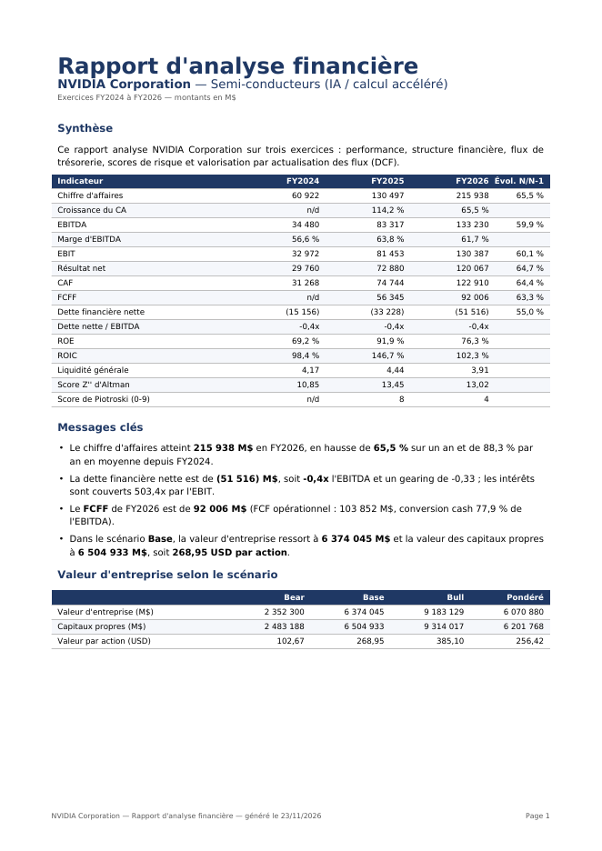
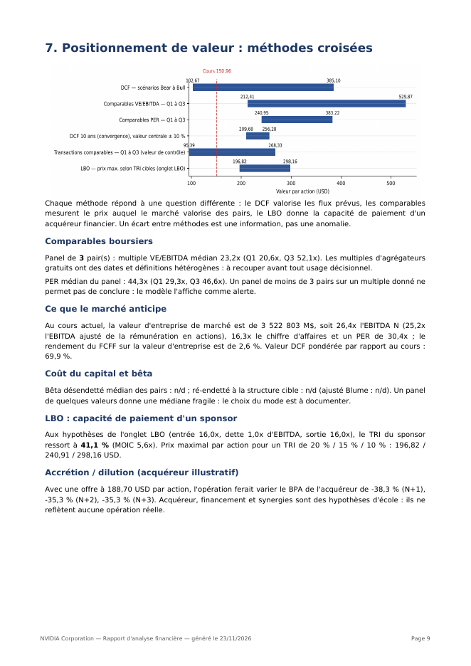
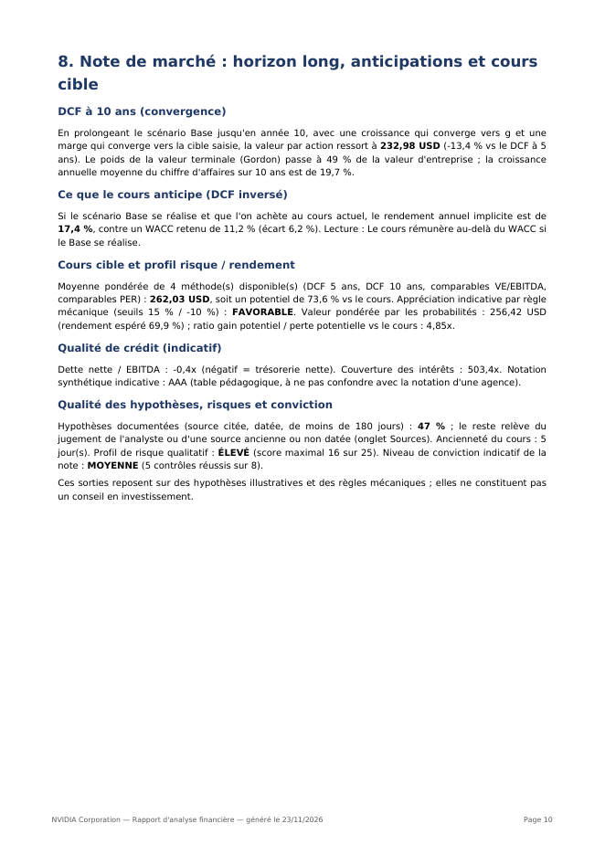

# finance-toolkit — automated financial analysis and valuation

 

> **Disclaimer.** Educational analysis tool. The valuation assumptions in the examples are **illustrative**, peer data comes from free and sometimes dated sources, and the "assessment" in the market note is a mechanical rule. Nothing here is investment advice or a recommendation.

Paste a balance sheet and an income statement (3 years) into an Excel workbook and everything else computes with live formulas and no macros: operating balances, cash flow capacity, working capital, ratios, scores (Altman, Piotroski), DuPont, year-on-year variations, a **3-scenario DCF**, **trading comps / football field**, **peer betas**, **LBO**, **accretion/dilution**, a **10-year DCF with fade**, a **reverse DCF** (return implied by the share price), **precedent transactions** and a **market note** (target price, risk/reward, synthetic credit rating, conviction level). A **sources register**, **dated market data with consensus** and a **qualitative analysis** (competition, risks, catalysts) document the assumptions. A script then builds a PDF report.

*(Version française : [README.fr.md](README.fr.md))*

## Preview
| PDF report (cover) | Cross-checked methods (football field) | Market note |
|---|---|---|
|  |  |  |

*NVIDIA example, illustrative assumptions.*

## Quick start
```bash
pip install -r requirements.txt
python src/build_workbook.py --blank --out Template.xlsx                                        # blank workbook
python src/build_workbook.py --data data/examples/wavestone_public.json --out Wavestone.xlsx    # real example
python src/build_workbook.py --data data/examples/lvmh_public.json --out LVMH.xlsx              # large group
python src/build_workbook.py --data data/examples/nvidia_public.json --out NVIDIA.xlsx          # US GAAP, hypergrowth
python src/analyse.py Wavestone.xlsx Report.pdf                                                 # PDF report
python -m pytest -q                                                                             # tests
```
Import a trial balance or a French FEC file: `python src/import_balance.py --template Template.xlsx --out Case.xlsx --files tb_N-2.csv tb_N-1.csv tb_N.csv` (editable French chart-of-accounts mapping: `data/pcg_mapping.csv`).

In Excel: fill in the **Saisie** sheet (yellow cells), set **Hypotheses**, and check that every control in **Synthese** reads "OK".

## Contents
| Folder | Purpose |
|---|---|
| `src/` | workbook generator, PDF report, trial balance / FEC import |
| `data/examples/` | fictitious company, **Wavestone**, **LVMH** and **NVIDIA** (public data), generated workbooks and PDF reports |
| `data/samples/` | synthetic trial balances (no real data) |
| `data/peers/` | semiconductor peer panel (FY2023-24 fundamentals, SEC source) and its source note |
| `tools/` | synthetic trial balance generator, peer panel builder (`requirements-peers.txt`) |
| `tests/` | 79 tests: zero formula errors, accounting consistency, valuation, import round-trip, validation against published figures |
| `docs/` | `METHODOLOGIE.md`, `VALIDATION.md` (gaps and defects found) |

## Validation and limits
The model reproduces the published figures of Wavestone (`docs/VALIDATION.md`), LVMH (`docs/VALIDATION_LVMH.md`) and NVIDIA under US GAAP (`docs/VALIDATION_NVIDIA.md`): sales, operating income, net income, balance sheet total, EBITDA, net cash. These notes also detail the **definitional gaps** and what the validation does not prove. The valuation assumptions provided are illustrative; peer data comes from free aggregators and must be cross-checked. **Educational analysis tool: not investment advice.** Note that the documents in `docs/` are written in French.

## Workbook sheets
Saisie · Hypotheses · Synthese · **Reco_Marche** · SIG_CAF · Bilan_BFR · Cashflow · Ratios · Scores · Variations · DCF · Comparables · WACC_Pairs · LBO · MA · **DCF_10ans** · **Transactions** · **Sources** · **Marche** · **Qualitatif** · Seuils. Method details: `docs/METHODOLOGIE.md`. Sheet names are in French.

## Data and sources
Company figures: public press releases and registration documents (see each `docs/VALIDATION_*.md` note). Peer panel: SEC statements extracted from a GPL-licensed Hugging Face dataset; only computed ratios are versioned (`data/peers/README.md`). Share prices and market capitalisations in the examples come from free aggregators and are dated in the notes: replace them with a professional source for any serious use.

## Date of the NVIDIA example data
The NVIDIA example is frozen at 23 November 2026: closing price of 20 November 2026 ($125.53), Q3 FY2027 results (press release of 17 November 2026), analyst consensus of 18 November 2026. Peer multiples date from 28 October and 11 November 2026 and come from free aggregators; the workbook bounds the effect of this gap in the `Pont_Consensus` sheet. The 10% legal discount applied to the target is the author's judgment, not statistically calibrated. These figures age quickly: update them before any use.

## Contributing
Issues and pull requests are welcome: add a test (`tests/`) with every calculation change and keep zero formula errors (`python -m pytest -q`).

## Confidentiality
Never commit real client or employer data (trial balances, FEC files): `data/private/` is ignored by Git.

MIT licence.
